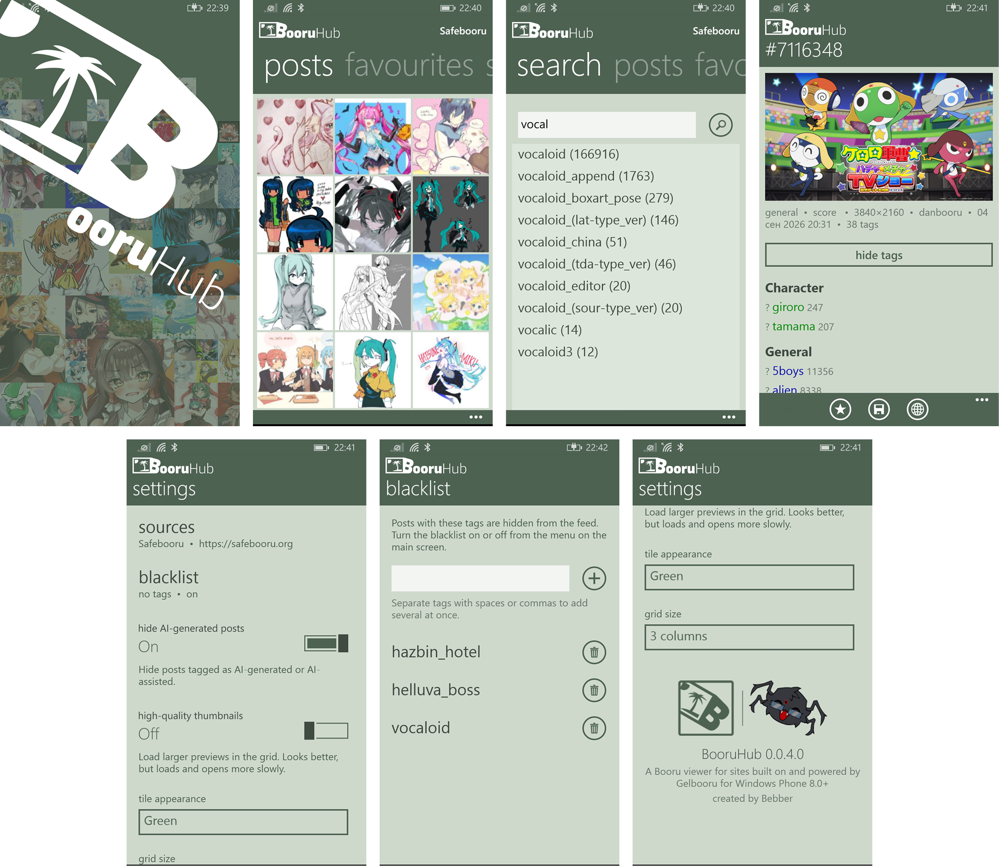

# BooruHub
 
A Booru viewer for sites built on and powered by Gelbooru for Windows Phone 8.0+

---
This simple client for WP allows you to fully browse the feed, zoom in on images, view GIFs and videos, search by tags, and add new data sources (specifically, sites built on the Gelbooru 0.2 framework—newer versions have not been verified or tested).

Some sites may require a CAPTCHA; this can be bypassed using a `clientid` and `api_key`. On certain sites, providing these credentials also allows you to log into your account, which in turn bypasses bot detection. 

Typically, you can obtain these credentials by navigating to: 
`My Account > Options > API Access Credentials > Generate New Key? > Save`

## Screenshots

